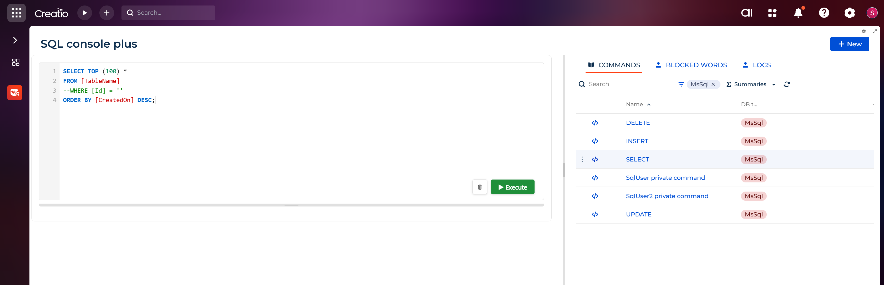
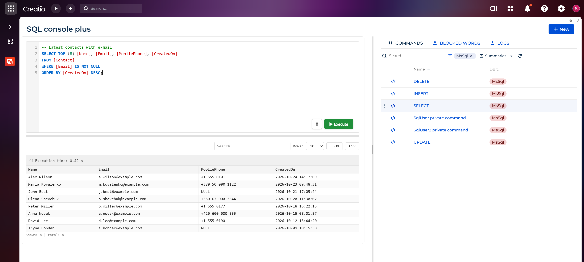
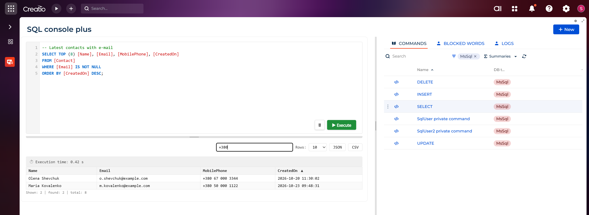
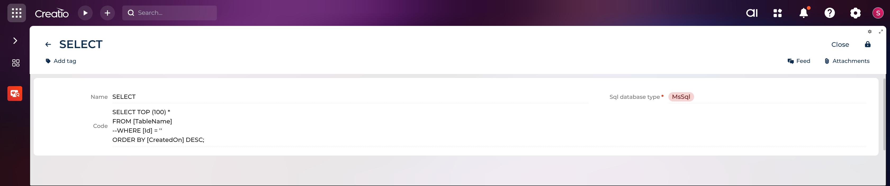
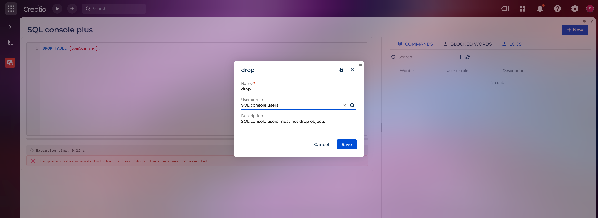
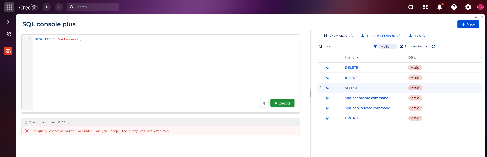
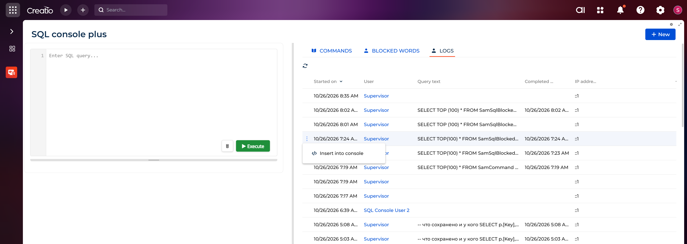
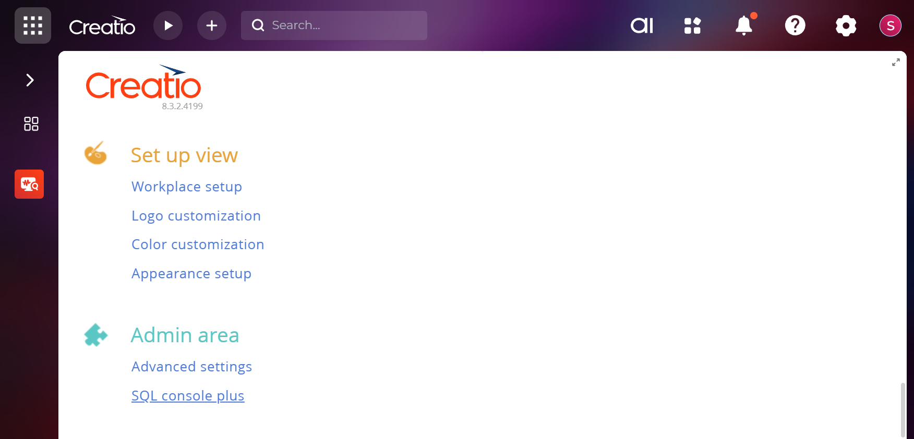

# SAM SQL Console Plus

**English** | [Українська](#uk)

A SQL console inside Creatio: a Freedom UI section where you write a SQL script, run it against the application database and see the result right away. It comes with saved commands, an execution log, blocked words and access control.

- Platform: **Creatio 8.3.2**, .NET Framework 4.7.2
- Package: [`SamConsolePlus`](./SamConsolePlus/) (depends on `CrtCore`, `CrtNUI`)
- Supported databases: MS SQL, PostgreSQL, Oracle



---

## Features

### SQL editor

- Syntax highlighting: keywords, strings, numbers, `[identifiers]`, `--` and `/* */` comments.
- Line numbers, `Tab` indentation, editor height adjustable by dragging its bottom edge.
- **▶ Execute** and **🗑 Clear** buttons sit right inside the editor.
- The width of the "editor / lists" panels is adjustable with the vertical splitter.

### Query result



- Execution time is shown for every run.
- A script with several result sets shows them as "Result 1", "Result 2", …
- `INSERT` / `UPDATE` / `DELETE` show the number of affected rows; on failure the database error text is shown.
- `NULL` values are displayed explicitly.



- **Sorting**: click a column header. Dates are sorted as dates, not as strings.
- **Search** across all cells of the result, with a "Shown / found / total" counter.
- **Row limit** on screen: 10 / 20 / 50 / 100.
- **Export** of the whole result to **JSON** or **CSV** (UTF-8 with BOM, `;` separator, so the file opens directly in Excel).

### Saved commands

The **Commands** tab is a library of SQL commands (the `SamCommand` object).

- The `</>` button or the **Insert into console** row menu item inserts the command text at the cursor position.
- When the page opens, the database type filter is set automatically to the database of the current environment.
- `SELECT` / `INSERT` / `UPDATE` / `DELETE` templates are included for each database type.
- Commands support record permissions: every user keeps personal commands and can share them with colleagues via the access rights button on the form.



### Blocked words

The **Blocked words** tab lists words that a script must not contain (the `SamSqlBlockedWord` object).



- A rule applies to a specific user, to a role (including the role hierarchy), or to everyone when **User or role** is empty.
- Words are matched as whole words, case-insensitively: `drop` matches `DROP TABLE` but not `dropdown`.
- A script containing a blocked word is not executed, and the user sees exactly which words blocked it:



The package ships with an empty list; administrators fill it in. Blocked words are also available in the **Lookups** section.

### Execution log

The **Logs** tab records every console call (the `SamSqlConsoleLog` object): who ran it, the query text, start and completion time, and the IP address.



- The log record is created **before** the script runs. An empty **Completed on** means the query was rejected or failed.
- The **Insert into console** row menu item brings a query from the log back into the editor.
- The log is read-only.

### Access to the console

- The console works only for users granted the **`CanUseSqlConsole`** system operation. The service checks it before any execution; without it the user sees "Access denied".
- On installation the operation is granted to **System administrators**. Grant it to other roles manually in **Operation permissions**.
- The **SQL console plus** link appears in the System Designer (**Admin area**) and checks the same permission:



---

## Installation

### Quick install (ready-made package)

Download [`SamConsolePlus.gz`](./SamConsolePlus.gz) and install it with [clio](https://github.com/Advance-Technologies-Foundation/clio):

```powershell
clio push-pkg SamConsolePlus.gz -e <env>
clio restart-web-app -e <env>
```

### Build from source

The project references the binaries of a deployed Creatio environment (`../../bin`), so it builds only inside the `Terrasoft.WebApp/Terrasoft.Configuration/Pkg` folder of an environment.

1. Copy the [`SamConsolePlus`](./SamConsolePlus/) folder into `Pkg` of your environment and run the commands below from `Pkg`.
2. Build the package assembly:

   ```powershell
   # Output → SamConsolePlus/Files/Bin/SamConsolePlus.dll
   dotnet build SamConsolePlus\Files\SamConsolePlus.csproj --property WarningLevel=0 -nowarn:MSB3277
   ```

3. Create the package file, or install straight from the folder:

   ```powershell
   clio generate-pkg-zip SamConsolePlus -d SamConsolePlus.gz
   # …or
   clio push-pkg SamConsolePlus -e <env>
   ```

After installation:

1. Grant the `CanUseSqlConsole` operation to the required roles (**System Designer → Operation permissions**).
2. Fill in **Blocked words** if needed.
3. Open the console via **System Designer → Admin area → SQL console plus** or from the **My applications** workplace.

## Package contents

| Schema | Purpose |
| --- | --- |
| `Command_ListPage` | Console page (Freedom UI): editor, result, Commands / Blocked words / Logs tabs |
| `SamCodeEditor` | Editor AMD module: highlighting, splitters, result grid, sorting, search, export |
| `SamSqlConsoleService` | REST service `/rest/SamSqlConsoleService/`: `ExecuteSqlScript`, `GetDatabaseType` |
| `SamCommand`, `Command_FormPage` | Saved commands and their form |
| `SamSqlDatabaseType` | Database type lookup (MsSql / PostgreSql / Oracle) with colored chips |
| `SamSqlBlockedWord`, `SamSqlBlockedWord_MiniPage` | Blocked words and their edit dialog |
| `SamSqlConsoleLog` | Execution log |
| `SystemDesigner` | Console link in the System Designer |

> ⚠️ The console runs arbitrary SQL on behalf of the application. Grant `CanUseSqlConsole` only to people who really need direct database access.

<sub>Screenshots were taken on a Creatio 8.3.2 test environment. The rows in the result grids on screenshots 2–4 are demo data.</sub>

---
---

<a id="uk"></a>

# SAM SQL Console Plus (українською)

[English](#sam-sql-console-plus) | **Українська**

SQL-консоль всередині Creatio: розділ на Freedom UI, де можна написати SQL-скрипт, виконати його на базі застосунку й одразу побачити результат. У комплекті — збережені команди, журнал виконання, заборонені слова та права доступу.

- Платформа: **Creatio 8.3.2**, .NET Framework 4.7.2
- Пакет: [`SamConsolePlus`](./SamConsolePlus/) (залежить від `CrtCore`, `CrtNUI`)
- Підтримувані СУБД: MS SQL, PostgreSQL, Oracle


---

## Можливості

### Редактор SQL

- Підсвічування синтаксису: ключові слова, рядки, числа, `[ідентифікатори]`, коментарі `--` та `/* */`.
- Нумерація рядків, відступ клавішею `Tab`, висота редактора змінюється перетягуванням нижньої межі.
- Кнопки **▶ Execute** та **🗑 Clear** розташовані просто в редакторі.
- Ширину панелей «редактор / списки» можна змінювати вертикальним роздільником.

### Результат запиту


- Для кожного запуску показується час виконання.
- Кілька результуючих наборів в одному скрипті виводяться як «Результат 1», «Результат 2», …
- Для `INSERT` / `UPDATE` / `DELETE` виводиться кількість змінених рядків, у разі помилки — текст помилки СУБД.
- `NULL` у клітинках показується явно.


- **Сортування** — клік по заголовку колонки. Дати сортуються як дати, а не як рядки.
- **Пошук** по всіх клітинках результату з лічильником «Показано / знайдено / всього».
- **Ліміт рядків** на екрані: 10 / 20 / 50 / 100.
- **Експорт** усього результату в **JSON** або **CSV** (UTF-8 з BOM і роздільником `;`, файл одразу відкривається в Excel).

### Збережені команди

Вкладка **Commands** — бібліотека SQL-команд (об'єкт `SamCommand`).

- Кнопка `</>` або пункт меню рядка **Insert into console** вставляє текст команди в позицію курсора.
- Під час відкриття сторінки фільтр за типом СУБД автоматично встановлюється за СУБД поточного стенда.
- У комплекті є шаблони `SELECT` / `INSERT` / `UPDATE` / `DELETE` для кожної СУБД.
- На команди налаштовуються права на записи: кожен користувач веде особисті команди й може відкрити їх колегам кнопкою налаштування прав доступу на формі.


### Заборонені слова

Вкладка **Blocked words** — список слів, із якими скрипт виконувати не можна (об'єкт `SamSqlBlockedWord`).


- Заборона діє на конкретного користувача, на роль (з урахуванням ієрархії ролей) або на всіх, якщо поле **User or role** порожнє.
- Слово шукається цілим і без урахування регістру: `drop` знайде `DROP TABLE`, але не `dropdown`.
- Скрипт із забороненим словом не виконується, а користувач бачить, які саме слова його заблокували:


Пакет встановлюється з порожнім списком — його заповнюють адміністратори. Заборонені слова доступні також у розділі **Lookups**.

### Журнал виконання

Вкладка **Logs** фіксує кожен виклик консолі (об'єкт `SamSqlConsoleLog`): хто запустив, текст запиту, час початку й завершення, IP-адресу.


- Запис створюється **до** виконання скрипта. Якщо **Completed on** порожнє, запит було відхилено або він завершився помилкою.
- Пункт меню рядка **Insert into console** повертає запит із журналу в редактор.
- Журнал доступний лише для перегляду.

### Доступ до консолі

- Консоль працює лише для користувачів із системною операцією **`CanUseSqlConsole`**. Сервіс перевіряє її перед будь-яким виконанням; без неї користувач побачить «Доступ заборонено».
- Під час встановлення операція надається ролі **System administrators**. Іншим ролям її призначають вручну в **Operation permissions**.
- Посилання **SQL console plus** з'являється в дизайнері системи (**Admin area**) і перевіряє те саме право:


---

## Встановлення

### Швидке встановлення (готовий пакет)

Завантажте [`SamConsolePlus.gz`](./SamConsolePlus.gz) і встановіть його через [clio](https://github.com/Advance-Technologies-Foundation/clio):

```powershell
clio push-pkg SamConsolePlus.gz -e <env>
clio restart-web-app -e <env>
```

### Збірка з вихідного коду

Проєкт посилається на бінарні файли розгорнутого стенда Creatio (`../../bin`), тому збирається лише всередині папки `Terrasoft.WebApp/Terrasoft.Configuration/Pkg` стенда.

1. Скопіюйте папку [`SamConsolePlus`](./SamConsolePlus/) у `Pkg` вашого стенда й виконуйте команди нижче з `Pkg`.
2. Зберіть складання пакета:

   ```powershell
   # Результат → SamConsolePlus/Files/Bin/SamConsolePlus.dll
   dotnet build SamConsolePlus\Files\SamConsolePlus.csproj --property WarningLevel=0 -nowarn:MSB3277
   ```

3. Сформуйте файл пакета або встановіть напряму з папки:

   ```powershell
   clio generate-pkg-zip SamConsolePlus -d SamConsolePlus.gz
   # …або
   clio push-pkg SamConsolePlus -e <env>
   ```

Після встановлення:

1. Надайте операцію `CanUseSqlConsole` потрібним ролям (**System Designer → Operation permissions**).
2. За потреби заповніть **Blocked words**.
3. Відкрийте консоль через **System Designer → Admin area → SQL console plus** або з робочого місця **My applications**.

## Склад пакета

| Схема | Призначення |
| --- | --- |
| `Command_ListPage` | Сторінка консолі (Freedom UI): редактор, результат, вкладки Commands / Blocked words / Logs |
| `SamCodeEditor` | AMD-модуль редактора: підсвічування, роздільники, таблиця результату, сортування, пошук, експорт |
| `SamSqlConsoleService` | REST-сервіс `/rest/SamSqlConsoleService/`: `ExecuteSqlScript`, `GetDatabaseType` |
| `SamCommand`, `Command_FormPage` | Збережені команди та їхня форма |
| `SamSqlDatabaseType` | Довідник СУБД (MsSql / PostgreSql / Oracle) з кольоровими мітками |
| `SamSqlBlockedWord`, `SamSqlBlockedWord_MiniPage` | Заборонені слова та вікно їх редагування |
| `SamSqlConsoleLog` | Журнал виконання |
| `SystemDesigner` | Посилання на консоль у дизайнері системи |

> ⚠️ Консоль виконує довільний SQL від імені застосунку. Право `CanUseSqlConsole` надавайте лише тим, кому справді потрібен прямий доступ до бази.

<sub>Скриншоти зроблено на тестовому стенді Creatio 8.3.2. Рядки в таблицях результату на скриншотах 2–4 — демонстраційні дані.</sub>
